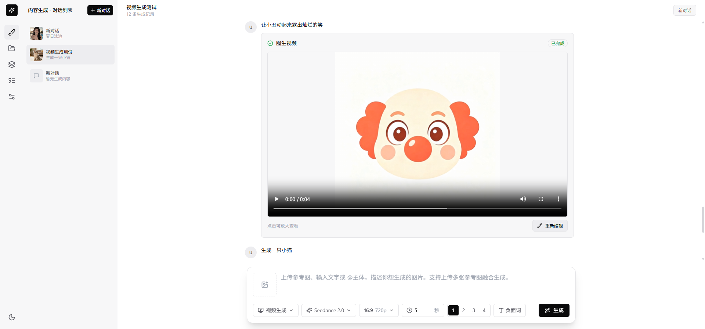
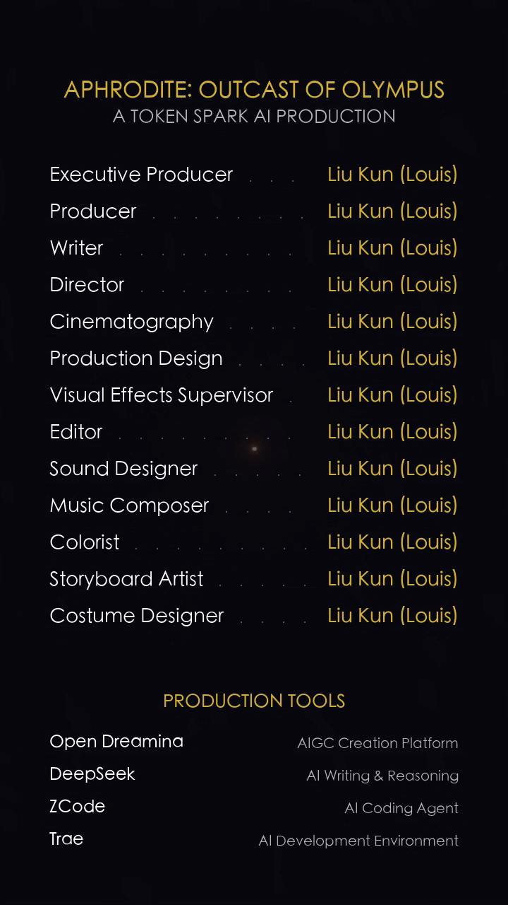

# Open Dreamina

### 生成靠模型，定稿靠眼睛。

本地部署的 AIGC 内容生成工具套件，通过 CLI 与 MCP 向智能体开放生成能力。智能体批量生成图像与视频，人工在审阅中心打分、填写批注并选定保留版本，未通过项依据批注重生成。素材、生成记录与密钥均存储于本地。

设计参考 [即梦](https://jimeng.jianying.com/)。

**快速部署**：`bash deploy.sh`（Linux / macOS）或 `pwsh .\deploy.ps1`（Windows），详见 [快速开始](#快速开始)。智能体接入见 [CLI](cli/README.md) 与 [MCP](mcp/README.md)。

Apache-2.0 · Docker Compose · Windows / Linux / macOS

---

## 适用范围

面向通过智能体执行批量生成的内容团队、短剧制作团队，以及要求数据不出本地的部署环境。

[《代号奥林匹斯》](#case-aphrodite)为已验证的实战案例：40 集 × 90 秒、724 个镜头，1 人 3 天完成。

本项目不提供云端多人协同与账号体系，部署依赖 Docker Compose；单次轻量生成需求建议直接使用在线创作工具。

---

## 快速开始

前置条件：Docker 与 Docker Compose，端口 `10131` / `10130` 未被占用。部署脚本完成环境检查、生成 `.env`（含随机加密密钥）、构建镜像与健康检查。

```text
bash deploy.sh        # Linux / macOS
pwsh .\deploy.ps1     # Windows（建议 PowerShell 7）
```

完成后访问 <http://localhost:10131>，API 文档在 <http://localhost:10130/docs>。在「设置 → 服务管理」配置模型服务即可开始生成；数据全部保存在 `./data`。

也可将下列指令交给 Codex、WorkBuddy 等智能体，由它按 [AGENTS.md](AGENTS.md) 完成部署：

> 克隆 https://github.com/Token-Spark/open-dreamina 到本地，按照仓库 AGENTS.md 引导完成部署，最后告诉我访问地址。

---

## 核心能力

- **生成**：支持 GPT Image 2、Seedream、Seedance、即梦 CLI、可灵、通义万相、Stability AI 等十余项服务；节点式画布连线传递参考素材；3D 导演台采集姿态画面作为参考图。完整目录见 [modelServices.json](frontend/src/config/modelServices.json)。
- **智能体**：CLI 全部输出 JSON（纯标准库零依赖）、18 个 MCP 工具、7 套按需加载的 AIGC 技能，以及 `opendreamina drama` 短剧工具链。
- **人工审阅**：任务卡片呈现待审内容（内容类型 / 剧目 / 剧集 / 镜头标签），卡片内直接看片、改提示词并复用创作页生成模块重新生成，结果一键采用为同镜号新版本；逐镜 0–100 打分、多版本并排对比、选定保留版本；审阅动作自动归档为 markdown。
- **本地部署**：无账号体系；素材、任务、批注、备份与密钥均保存在 `./data`；外部素材目录默认只读挂载。

---

## 工作流程

1. `opendreamina skills` 列出可用技能，智能体选择并加载。
2. 通过 CLI 或 MCP 提交生成任务，产物写入 `./data`。
3. 人工在审阅中心按任务卡片逐条打分、填写批注；不满意的镜头在卡片内直接改提示词重新生成，结果采用为新版本后选定保留版本。
4. 未通过项依据批注重生成，返回第 2 步；终审通过后归档。

各环节以文件与 JSON 交接，人工与智能体均可从任一环节介入。



---

<a name="case-aphrodite"></a>

## 案例：代号奥林匹斯

发行名称：APHRODITE: THE OUTCAST OF. OLYMPUS.（[TikTok 发行链接](https://www.tiktok.com/t/ZPL4yVsyC/)）；片尾署名：APHRODITE: OUTCAST OF OLYMPUS（A TOKEN SPARK AI PRODUCTION）。

AI 仿真人竖屏短剧，40 集 × 90 秒、724 个镜头，1 人 3 天完成。剧本与分镜经 `opendreamina drama` 校验并编译为 Seedance 提示词，批量生成后由 `shot-reviewer` 初审，人工在审阅中心批注、选定版本，未通过项依据批注重生成。仓库内的 `drama` 工具链与技能体系即由该项目提炼。

片尾职员表所有职位由一人承担，制作工具栏列有 Open Dreamina。



图为成片片尾字幕。

---

## 详细文档

| 文档 | 内容 |
| --- | --- |
| [AGENTS.md](AGENTS.md) | 部署与更新、环境变量、可选配置、运维、故障排查、审阅中心挂载与路径安全 |
| [cli/README.md](cli/README.md) | CLI 全部子命令、参数、退出码与智能体接入流程 |
| [mcp/README.md](mcp/README.md) | 18 个 MCP 工具与客户端配置 |
| [drama/README.md](drama/README.md) | 短剧分镜工具链与标准项目目录 |
| [.skills/](.skills/) | 7 套 AIGC 技能定义（SKILL.md） |

---

## 社区交流

获取使用帮助与最新动态，可扫码加入飞书话题群。


